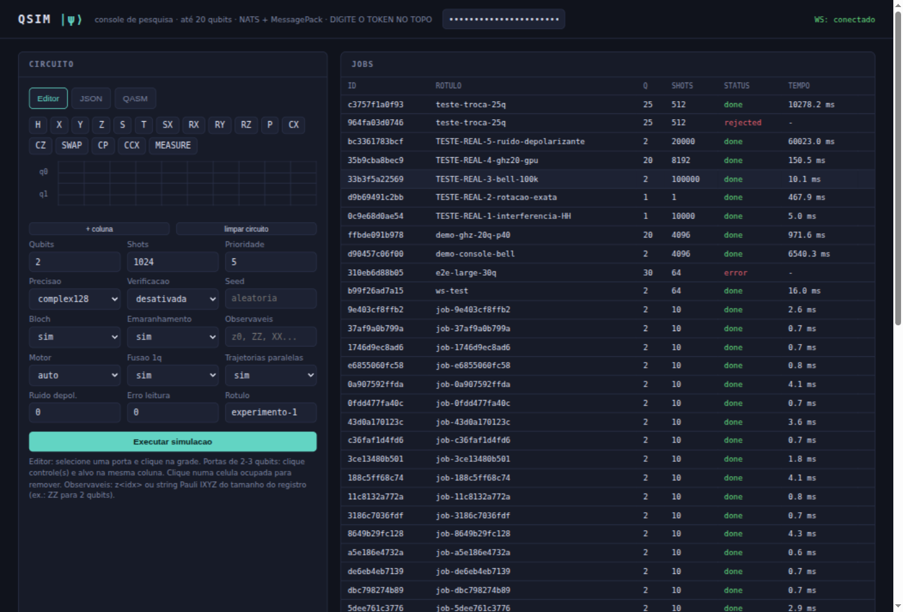

# QSim

Simulador teórico-empírico de computador quântico (até 31 qubits) em
microserviços: NATS + MessagePack internamente, console web de pesquisa e
administração na porta 10000, monitoramento Prometheus/Grafana.

## Subir o sistema
    docker compose up --build                    # CPU (dev)
    docker compose --profile gpu up --build      # com as GPUs (um worker por placa)
    docker compose -f docker-compose.yml -f docker-compose.secure.yml up   # NATS com contas

    export QSIM_ADMIN_TOKEN=um-token-forte       # obrigatório fora de dev

Console: http://localhost:10000 — Grafana: http://localhost:3000 (dashboard
"QSim - Visão Geral") — Prometheus: http://localhost:9090.

Configuração local no `.env` (lido automaticamente pelo compose; não é
versionado — veja `.env.example` abaixo):

    QSIM_MAX_QUBITS=20    # teto de qubits aceito no gateway/validação/QASM (1-31)
    QSIM_ADMIN_TOKEN=...  # token do console; vazio = sem autenticação (dev)

## Console web

Captura do console durante a bateria `TESTE-REAL-*` (login por token,
lista de jobs com status, histograma do estado de Bell com 100 mil shots
em 50/50, observáveis ⟨ZZ⟩=⟨XX⟩=1, verificação cruzada c128/c64 APROVADA
e entropia de emaranhamento de 1 bit por qubit). A validação completa
(teoria vs simulador: interferência, rotação exata, Bell, GHZ-20 na GPU
Tesla P40 e ruído depolarizante) está descrita em docs/PESQUISA.md.

## Serviços

    services/engine      worker de simulação (NumPy/CuPy, c64/c128, classes por capacidade)
    services/scheduler   fila de prioridades, roteamento por classe, quotas, cancelamento
    services/gateway     única fronteira HTTP: console web, REST, WebSocket, SQLite, exports
    sdk/qsim_client.py   cliente Python direto no NATS (run, sweep, cancel)
    shared/              settings (pydantic-settings, prefixo QSIM_), bus NATS, validação, logging

## Uso rápido (REST)

    curl -X POST http://localhost:10000/api/jobs \
      -H "Authorization: Bearer $QSIM_ADMIN_TOKEN" \
      -H "Content-Type: application/json" \
      -d '{"num_qubits": 2, "shots": 4096, "verify": true,
           "observables": ["ZZ"], "return_entanglement": true,
           "operations": [{"gate": "h", "targets": [0]},
                          {"gate": "cx", "targets": [0, 1]}]}'

Também aceita OpenQASM no campo `qasm`, prioridade 0-9, ruído global/por
porta/por qubit, cancelamento em `POST /api/jobs/{id}/cancel` e exportação em
`GET /api/jobs/{id}/export?fmt=json|csv|latex`.

## Testes

    PYTHONPATH=. python3 tests/test_physics.py        # oráculo físico
    PYTHONPATH=. python3 tests/test_metamorphic.py    # identidades de circuito
    PYTHONPATH=. python3 tests/test_differential.py   # c64 vs c128, CPU vs GPU
    PYTHONPATH=. python3 tests/test_research.py       # QASM, Pauli, Bloch, ruído, cancelamento
    PYTHONPATH=. python3 tests/test_security.py       # entradas hostis
    PYTHONPATH=. python3 tests/fuzz.py 300            # fuzzer
    PYTHONPATH=. python3 tests/test_aer_crosscheck.py # vs Qiskit Aer (opcional)
    PYTHONPATH=. python3 tests/integration_e2e.py     # ponta a ponta (requer nats-server)
    PYTHONPATH=. python3 tests/test_gpu.py            # validacao GPU/custatevec/numba (na maquina com as placas)
    PYTHONPATH=. python3 tests/test_backend_aer.py    # motor C++ Aer com paridade de recursos
    PYTHONPATH=. python3 tests/test_noise_channels.py # canais vs formulas analiticas e paridade entre motores
    k6 run tests/load/k6_gateway.js                   # carga no gateway

## Documentação

    docs/PLANEJAMENTO.md       arquitetura, decisões, fases (1-4 entregues, 5 futura)
    docs/PESQUISA.md           guia de uso para pesquisa (web, SDK, receitas, exports)
    docs/LINHAS_DE_PESQUISA.md como sair de uma pergunta cientifica e chegar a um
                               experimento; linhas relacionadas, correlatas e distintas;
                               experimentos A a E com saidas reais (scripts em examples/)
    docs/PLANO_DE_MELHORIA.md  avaliação profunda, comparativo com outros simuladores
                               e plano de melhoria em fases (P0-P4) com critérios de aceite
    docs/EXECUCAO_PLANO.md     o que foi executado do plano, validações e KPIs medidos
    docs/TESTES_PRATICOS.md    receitas prontas de experimentos (console, curl, SDK)
                               com saídas reais medidas e como interpretá-las
    CHANGELOG.md               histórico de mudanças
    requirements-gpu.txt       dependencias opcionais: cupy-cuda12x, cuquantum (Volta+), numba

Backends: `numpy` (referência), `cupy` (GPU, kernels in-place até 31 qubits
na VRAM), `custatevec` (Volta+), `aer`/`aer-gpu` (motor C++), `clifford`
(tableau O(n²) — milhares de qubits em circuitos Clifford, com auto-rota
acima de 20 qubits) e `auto`, que escolhe o motor instalado conforme o circuito
(ruído vai para o Aer; exato prefere aer-gpu, cupy, aer, numpy) e grava a
escolha em `metadata.backend_resolved`.
